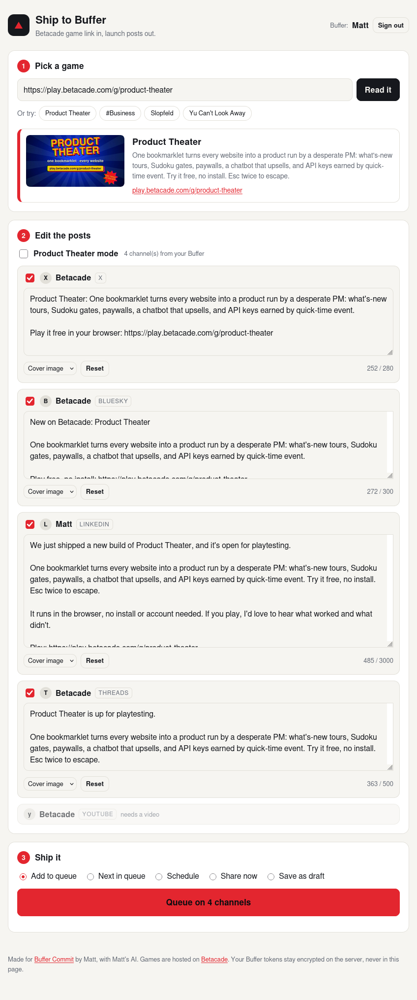
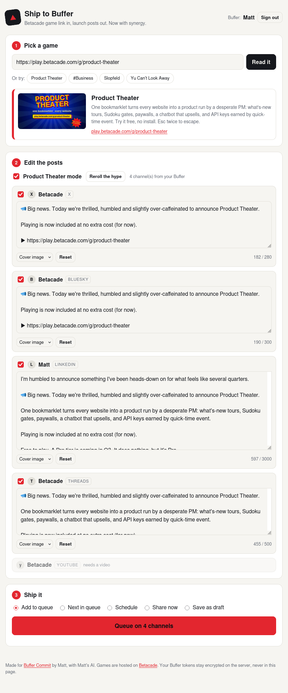

# Ship to Buffer

Paste a Betacade game link, get a launch post for every channel in your Buffer, edit them, and queue or schedule them all in one click.

Built for [Buffer Commit](https://buffer.com/api/commit), November 2026.



## What it does

[Betacade](https://betacade.com) hosts web game builds for playtesting. Every public game has a play page, `play.betacade.com/g/<game>`, with a title, a description, a cover image and a brand color. The hard part of a playtest isn't the build, it's getting people to play it. Ship to Buffer closes that gap:

1. **Connect Buffer** with OAuth (Authorization Code + PKCE).
2. **Pick a game**: paste its link, or tap one of the demo games.
3. **Edit the posts**: one draft per connected channel, written for that network. X stays under 280 with the link counted as 23, Bluesky under 300 graphemes, Threads under 500, LinkedIn gets the longer version. A live counter uses Buffer's own counting rules, and the Ship button won't let an over-length post through.
4. **Choose the attachment** per channel: the game's cover image, a link card (Bluesky, LinkedIn, Threads, Facebook), or text only.
5. **Ship it**: add to queue, next in queue, schedule for a time, share now, or save as drafts. Results come back per channel, with when each post is due.

**Product Theater mode** rewrites every post as an announcement from a product manager with far too much power ("Introducing Product Theater: a game. We A/B tested the word \"game\" and it won."). Reroll the hype until it's right. Named after [Product Theater](https://play.betacade.com/g/product-theater), a bookmarklet toy hosted on Betacade.



## Buffer API surface used

- OAuth 2.0 Authorization Code with PKCE (S256) and `state`, at `auth.buffer.com/auth` and `/token`, including single-use rotating refresh tokens (`offline_access`).
- Scopes: `account:read posts:read posts:write offline_access`, nothing more.
- GraphQL at `api.buffer.com`:
  - `account { name organizations { id name } }`
  - `channels(input: { organizationId })`: service, avatar, disconnected, locked and paused-queue state
  - `createPost` with `schedulingType: automatic`, `mode` (`addToQueue`, `shareNext`, `shareNow`, `customScheduled` + `dueAt`), `saveToDraft`, `assets: [{ image: { url } }]`, `metadata.<service>.linkAttachment`, and the required Facebook and Instagram metadata. `PostActionSuccess` and `MutationError` are both handled and shown per channel.
- 401 signs the user out cleanly; 429 surfaces `Retry-After` instead of retrying.

## How it's built

One Cloudflare Worker, TypeScript, no framework and no runtime dependencies.

- `public/`: the page (plain HTML, CSS and an ES module). `public/draft.js` holds the drafting and counting rules, shared by the page and the tests.
- `src/worker.ts`: routes `/auth/login`, `/auth/callback`, `/auth/logout`, `/api/me`, `/api/game`, `/api/ship`; everything else is static assets.
- `src/session.ts`: Buffer tokens live in an AES-GCM encrypted, HttpOnly, Secure, SameSite=Lax cookie. Page JavaScript never sees a token.
- `src/game.ts`: reads a game's public play page. Only Betacade links are accepted and the fetch URL is rebuilt from the slug, so the Worker can't be pointed anywhere else. At ship time the cover and link are read from Betacade again rather than trusted from the page.
- Writes (`/api/ship`, `/auth/logout`) require a same-origin `Origin` header on top of SameSite cookies.
- `dev/mock-buffer.ts`: a local stand-in for Buffer's auth and GraphQL endpoints (and for Betacade) that enforces PKCE, state, the client secret, refresh-token rotation and reuse revocation, and createPost's typed errors.

## Run it

Needs Node 22.18 or newer (TypeScript runs natively).

```sh
npm test          # 20 tests: full OAuth round trip, refresh rotation, CSRF, SSRF, drafts
npm run dev       # http://localhost:8787 against the mock Buffer, real Betacade
```

## Deploy

```sh
npm install
npx wrangler login
# set BUFFER_CLIENT_ID in wrangler.toml, then:
npx wrangler secret put BUFFER_CLIENT_SECRET
openssl rand -base64 48 | npx wrangler secret put SESSION_SECRET
npx wrangler deploy
```

In Buffer, [Settings → API → App Clients](https://publish.buffer.com/settings/api), register a private client with the redirect URI `https://<your-worker-host>/auth/callback` and the permissions `account:read`, `posts:read`, `posts:write`.

## New work for Buffer Commit

Everything in this repository was built during the Buffer Commit build window (Oct 28 to Nov 13, 2026). Betacade itself, the games, and Product Theater existed before; this app only reads Betacade's public play pages and adds nothing to Betacade.

## Build in public

- **Nov 13, morning.** Read Buffer's developer docs end to end. Two things shaped the design: there's no media upload (images are public URLs, and Betacade covers already are), and refresh tokens are single-use, so reuse revokes the grant.
- **Nov 13.** Wrote a mock Buffer before the app, enforcing PKCE, state, rotation and reuse revocation, so every test exercises the real OAuth path rather than a shortcut.
- **Nov 13.** Built the Worker, drafts per network with Buffer's counting rules (X URLs are 23, Bluesky counts graphemes, Instagram line breaks count 2), then Product Theater mode.
- **Nov 13.** Drove the whole flow in headless Firefox: connect, draft, theater, ship to four channels.
